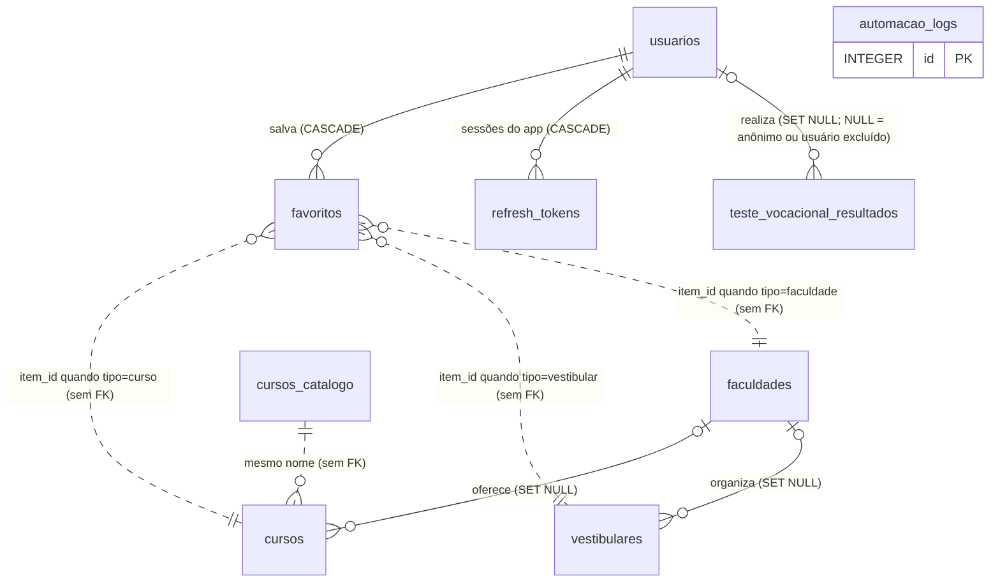
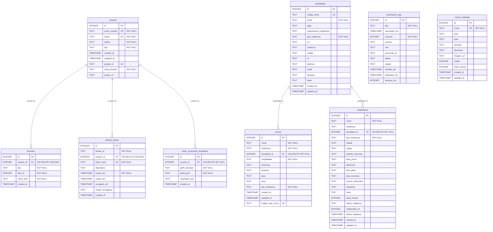
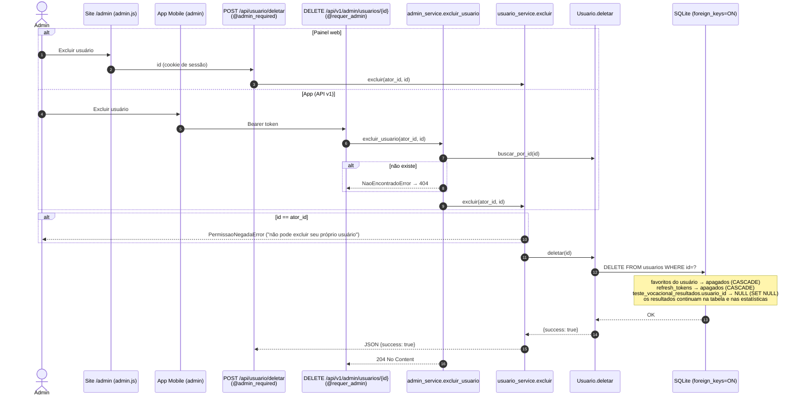
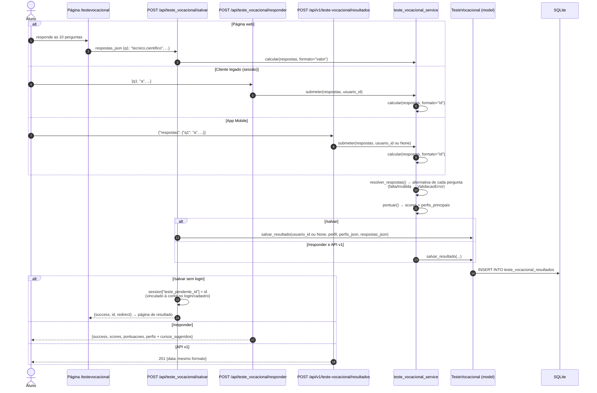
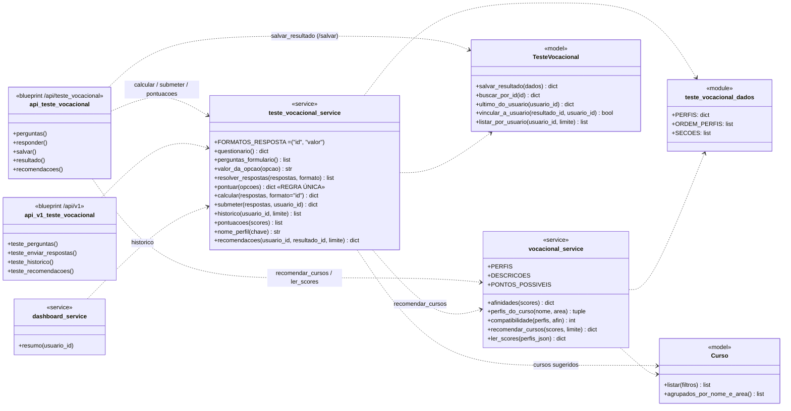

# Diagramas técnicos (fiéis ao código atual)

Versão em Mermaid (renderiza no GitHub/VS Code) dos diagramas da documentação
do projeto, revisados na auditoria técnica de 2026-11. Eles descrevem o código e
o banco **depois** das correções:

- `teste_vocacional_resultados.usuario_id` com `ON DELETE SET NULL`;
- tabela `vestibular_inscricoes` removida;
- pontuação do teste vocacional numa única implementação
  (`teste_vocacional_service.calcular`/`pontuar`).

> Se houver cópias desses diagramas fora do repositório (relatório do TCC,
> slides, ferramenta de modelagem), substitua-as por estas versões. O esquema
> do BD-03 foi gerado a partir de um banco criado pelo `database/init_db.py`
> (`PRAGMA table_info`/`foreign_key_list`) — não à mão.

## BD-00 — Diagrama geral do banco de dados

Linhas cheias = chave estrangeira real; pontilhadas = associação lógica sem FK.
`automacao_logs` não se relaciona com outras tabelas.

## BD-03 — Diagrama detalhado do banco de dados

Observações:

- `usuarios.google_id` e `cursos.codigo_inep_curso` são únicos só quando não nulos (índice parcial).
- `automacao_logs` tem índice único parcial em `tipo WHERE status='executando'` (trava de execução).
- Índices de apoio: `idx_teste_vocacional_usuario`, `idx_cursos_faculdade`, `idx_cursos_nome`,
  `idx_vestibulares_nome`, `idx_refresh_tokens_familia`, `idx_refresh_tokens_usuario`,
  `idx_automacao_tipo_status`.
- CHECKs: `usuarios.tipo IN ('aluno','admin')`, `faculdades.tipo_instituicao IN ('Pública','Privada')`,
  `favoritos.tipo IN ('curso','vestibular','faculdade')`; `UNIQUE(usuario_id, tipo, item_id)` em `favoritos`.

## SD-12 — Exclusão de usuário pelo painel administrativo

Os dois painéis (site e app) chegam ao mesmo `usuario_service.excluir` e ao mesmo
`DELETE`; as regras de FK do SQLite fazem o resto numa única instrução.

## SD-10 — Teste vocacional (envio das respostas)

Três entradas, uma regra: todas passam por `teste_vocacional_service.calcular`.

Depois do envio, a página de resultado (`GET /api/teste_vocacional/resultado` e
`/recomendacoes`) e o app (`GET /api/v1/teste-vocacional/recomendacoes`) leem o
resultado salvo e calculam a compatibilidade com `vocacional_service.recomendar_cursos`.

## CL-05 — Classes do teste vocacional

Os serviços são módulos Python (funções), representados como classes `<<service>>`.

Removidos nesta revisão: `vocacional_service.calcular_pontuacao`,
`vocacional_service.validar_respostas` e `vocacional_service.RespostasInvalidas`
(eram a segunda implementação da pontuação, usada só por `/salvar`).
